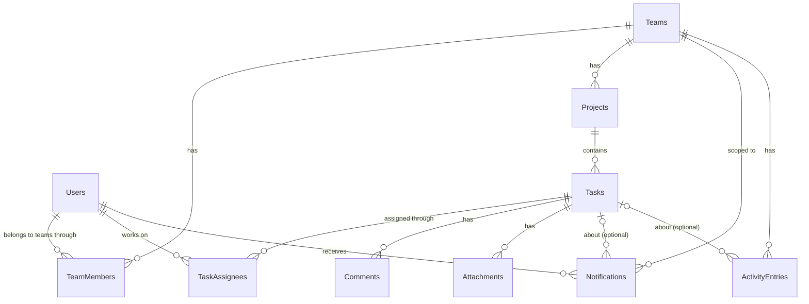

# Atlas data model (Sprint 5)

Atlas stores its data in SQL Server through Entity Framework Core. The classes are in `src/AtlasTaskFlow/Models/`, the
mapping (keys, relationships, sizes, indexes) is in `src/AtlasTaskFlow/Data/AtlasDbContext.cs`, and the schema is
created by the migration in `src/AtlasTaskFlow/Data/Migrations/`.

## What Atlas needs to remember

| Table | Why it exists | Primary key | Important columns and rules |
| --- | --- | --- | --- |
| Users | The people who use Atlas | `UserId` (identity) | `FullName` ≤100, required; `Email` ≤256, required, **unique** |
| Teams | Each small business is a separate workspace | `TeamId` | `TeamName` ≤100, required; `CreatedByUserId` → Users |
| TeamMembers | Who belongs to which team, and their role there | `TeamMemberId` | `Role` (Leader / Member); `HasManagerPermissions`; **unique (TeamId, UserId)** |
| Projects | Groups tasks inside a team, including the default "Tasks" project | `ProjectId` | `ProjectName` ≤80, required, **unique within a team**; `Description` ≤500; `IsDefaultTasksProject` |
| Tasks | The unit of work (class `TaskItem`) | `TaskId` | `Title` ≤100, required; `Description` ≤2000; `Status` (five values); `DueDate` (`date`); `CompletedAt` |
| TaskAssignees | Zero, one or many people on a task | **(TaskId, UserId)** | Composite key, so the same person can't be assigned twice |
| Comments | The discussion thread on a task | `CommentId` | `MessageText` ≤1000, required |
| Attachments | Reference files and submitted deliverables | `AttachmentId` | `FileName` ≤255; `ContentType`; `FileType` (Reference / FinalDeliverable); `Content` (`varbinary(max)`, 5 MB limit set by the app) |
| Notifications | The bell: what each person needs to know, per team | `NotificationId` | `Message` ≤500; `IsRead`; `TaskId` optional |
| ActivityEntries | The dashboard's recent activity feed | `ActivityEntryId` | `Message` ≤500; `TaskId` optional |

Dates and times are stored in UTC except `DueDate`, which is a plain calendar date.

## Relationships

Many-to-many relationships use junction tables: Users ↔ Teams through **TeamMembers** (which also carries the role),
and Tasks ↔ Users through **TaskAssignees**.

## What happens on delete

| When this is deleted | These go with it | These stay |
| --- | --- | --- |
| A task | Its assignees, comments and files (database cascade) | Notifications and activity lines; their `TaskId` is cleared by the app |
| A team (not possible in the app yet) | Its members, projects, tasks, notifications and activity | Users |
| A user (not possible in the app yet) | Blocked while they own any data (`Restrict`) | Everything |

SQL Server won't allow two cascade paths into one table. Notifications can be reached from Teams directly and from
Teams → Projects → Tasks, so the Tasks → Notifications link is `NO ACTION` in the database and the app clears it
(`AtlasStore.DeleteTask`). The same applies to ActivityEntries. See [DEV-LOG](DEV-LOG.md) §3.

## Decisions

- Enums (`Status`, `Role`, `FileType`) are stored as their names, such as `NeedsReview`, not numbers, so the tables can
  be read directly and reordering an enum can't change saved data.
- Each user action is saved in one `SaveChanges` call, which SQL Server runs as one transaction, so an action is saved
  completely or not at all ([DR-0008](../roadmap/decisions/DR-0008-migrate-and-save-per-action.md)).
- The rules are enforced twice: by the forms and workflow service (friendly messages) and by the database (keys, sizes,
  unique indexes), so bad data can't get in even through a bug.
- Files are stored in the database ([DR-0007](../roadmap/decisions/DR-0007-files-in-database.md)).
- SQL Server everywhere: LocalDB on the developer PC, Azure SQL Database live
  ([DR-0006](../roadmap/decisions/DR-0006-ef-core-sql-server.md)).
